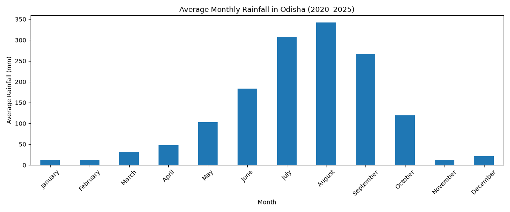
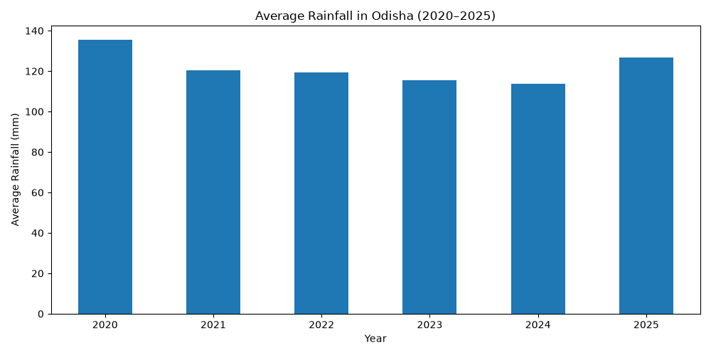
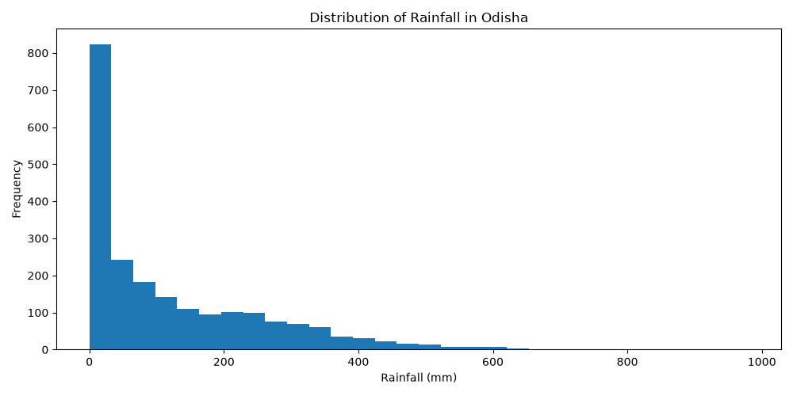
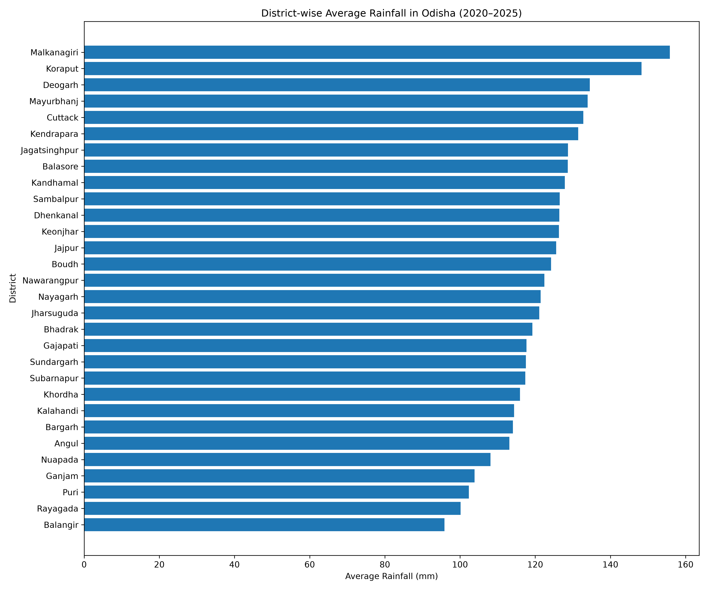
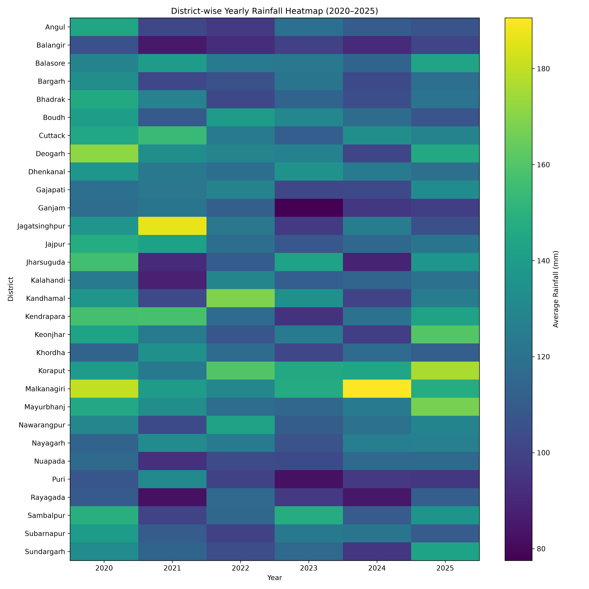
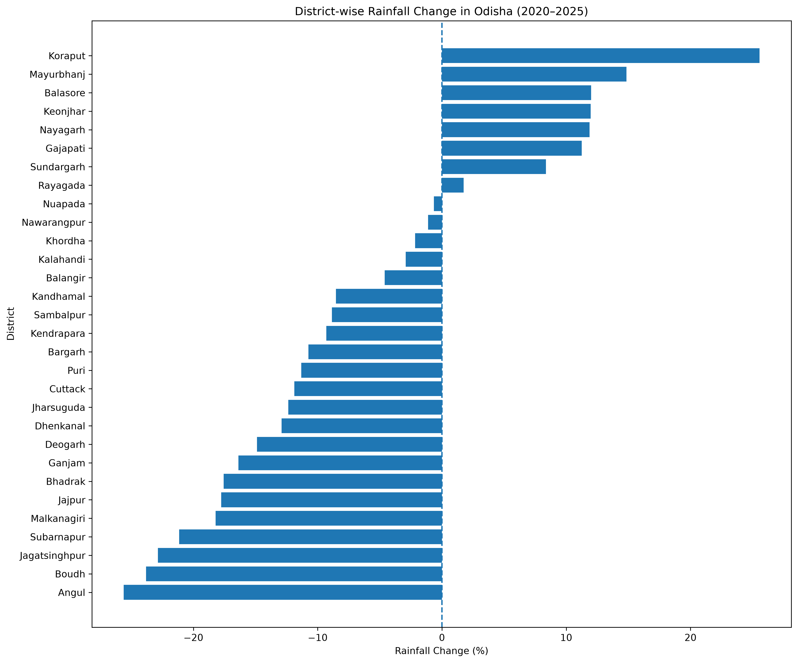

# Odisha Rainfall Analysis (2020–2025)

## 📌 Project Overview

The **Odisha Rainfall Analysis** project explores district-wise rainfall patterns across Odisha from 2020 to 2025.

The project uses rainfall data collected from Excel workbooks and applies Python-based data processing, exploratory data analysis (EDA), and data visualization to identify rainfall patterns, compare districts, and examine changes across the six-year period.

## 🎯 Project Objectives

- Analyze rainfall patterns across 30 districts of Odisha.
- Study monthly and yearly rainfall variations.
- Compare average rainfall between districts.
- Identify districts with relatively high and low rainfall.
- Visualize rainfall distribution using charts and a heatmap.
- Compare district-level rainfall averages between 2020 and 2025.

## 🛠️ Technologies Used

- **Python** – Data processing and analysis
- **Pandas** – Data cleaning and manipulation
- **Matplotlib** – Data visualization
- **Seaborn** – Statistical visualization
- **Excel** – Source data format

## 📂 Project Structure

```text
ODISHA-RAINFALL-ANALYSIS/
│
├── data/
│   ├── raw/
│   │   ├── rainfall_2020.xls
│   │   ├── rainfall_2021.xls
│   │   ├── rainfall_2022.xls
│   │   ├── rainfall_2023.xls
│   │   ├── rainfall_2024.xls
│   │   └── rainfall_2025.xls
│   │
│   └── processed/
│       ├── odisha_rainfall_2020_2025.csv
│       ├── district_rainfall_analysis.csv
│       ├── district_year_comparison.csv
│       └── rainfall_trends.csv
│
├── images/
│   ├── monthly_rainfall.png
│   ├── yearly_rainfall.png
│   ├── rainfall_distribution.png
│   ├── district_rainfall.png
│   ├── rainfall_heatmap.png
│   └── rainfall_trends.png
│
├── inspect_data.py
├── process_data.py
├── eda.py
├── visualizations.py
├── district_analysis.py
├── district_visualization.py
├── district_year_analysis.py
├── heatmap.py
├── rainfall_trends.py
├── rainfall_trend_visualization.py
│
└── README.md
```

## 📊 Analysis Performed

### 1. Data Collection and Processing
- Imported rainfall data from six Excel workbooks (2020–2025).
- Extracted district-wise monthly rainfall information.
- Cleaned district names and organized the data.
- Combined the data into a single dataset.

### 2. Exploratory Data Analysis
- Examined rainfall distribution and descriptive statistics.
- Analyzed monthly rainfall patterns.
- Compared average rainfall across years.
- Identified districts with higher and lower average rainfall.

### 3. District-wise Analysis
- Calculated average rainfall for each district.
- Compared district-level rainfall across different years.
- Identified districts with the highest and lowest average rainfall.

### 4. Rainfall Trend Comparison
- Compared district-level average monthly rainfall in 2020 and 2025.
- Identified districts with increasing and decreasing rainfall averages.
- Calculated percentage changes between the two years.

## 📈 Visualizations

### 1. Monthly Rainfall Analysis


### 2. Yearly Rainfall Analysis


### 3. Rainfall Distribution


### 4. District-wise Rainfall Analysis


### 5. Rainfall Heatmap


### 6. Rainfall Trend Comparison (2020–2025)


## 🔍 Key Findings

- The analysis covers **30 districts** over **6 years**.
- The processed dataset contains **2,160 observations**.
- July and August have the highest average monthly rainfall.
- Malkanagiri has the highest overall district average in the analyzed period.
- Koraput recorded the largest percentage increase in average monthly rainfall between 2020 and 2025.
- 8 districts showed an increase, while 22 districts showed a decrease in the two-year comparison.

## ⚠️ Scope and Limitations

- The analysis covers only the period from 2020 to 2025.
- The trend comparison uses 2020 and 2025 as its endpoints; it does not establish a continuous long-term climate trend.
- The findings are based on the district-level rainfall figures available in the source workbooks.

## 🚀 Project Outcome

This project demonstrates how Python can be used to process real-world rainfall data, perform exploratory analysis, compare regional patterns, and communicate findings through visualizations.

It provides a data-driven overview of rainfall variations across Odisha's districts during 2020–2025.

## 👨‍💻 Author

**Hitesh Kumar**